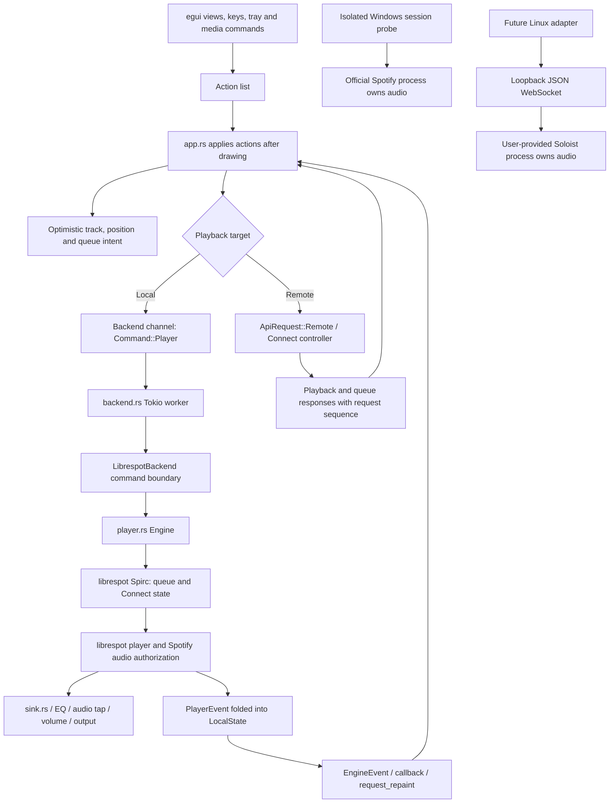
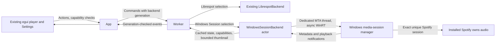

# Playback feasibility for the independent fork

Investigated on 2026-10-12, against local commit `0e87b95`. This checkout's
remote is `crmne/spotifast`, not a configured personal fork. Work stays on
`experimental-playback` and nothing is pushed. The requested fork scope
overrides upstream's restriction on alternative backends and work on main.
The MIT notice and upstream engineering checks still apply.

## Finding

There is no verified design here for lightweight, independent, advertisement-free
Spotify Free streaming. A native control interface is feasible. A Windows
companion still needs the official Spotify client to play audio. An official
Linux engine is now available separately, with important setup restrictions.
No account playback test has been performed in this investigation.

Spotify's [Soloist announcement](https://developer.spotify.com/blog/2026-08-13-introducing-spotify-soloist)
explicitly supports Free and Premium listeners after Premium setup. That is a
published capability, not a successful Free playback experiment in this fork.
Advertisement-free Free playback is not promised by the APIs examined.

## Existing architecture and command lifecycle

1. `ui/player_bar.rs` emits `Action::TogglePlay`, `Next`, `Previous` and seek
   actions. Collection views emit play requests with contexts or ordered URIs.
   `app.rs` drains actions after views finish drawing.
2. `App::target` chooses the local Connect engine or a remote device.
   `play_request`, `toggle_play`, `seek` and `apply` hold the user's immediate
   intent. Next pops the visible queue before dispatch. A reconnecting local
   engine retains the chosen load rather than choosing a song again later.
3. `Backend::player` sends a `PlayerCommand` to the dedicated Tokio worker.
   The worker invokes the local command interface. `Engine::command` interrupts
   queued audio where necessary and delegates to Spirc. A load activates the
   device and passes context, offsets, position, shuffle and repeat to Spirc.
4. Decoder events become `LocalState`. `engine_notify` checks the credential
   lease, forwards `Event::Local` and wakes egui. Unexpected session termination
   requests bounded reconnection. `handle_local` reconciles the displayed state.
   Remote Web API responses have sequence and optimistic-intent checks so old
   responses cannot undo a recent action.
5. `PlaybackResume` can retain the complete librespot queue snapshot in memory.
   Audio-setting replacement uses a track pickup. Sign-out invalidates grants
   and stale results; shutdown stops Spirc and the player.

## Source map and state ownership

| File | Responsibility and representation |
| --- | --- |
| `src/ui/player_bar.rs`, `ui/playlist.rs`, `ui/album.rs`, `ui/queue.rs`, `ui/keys.rs` | Draw views and emit `Action`s; no playback I/O |
| `src/app.rs` | `Action`, `Target`, `local: LocalState`, selected device, optimistic intent, pending loads, queue reconciliation and queue regression tests |
| `src/backend.rs` | `Command`/`Event`, `AuthStatus`, `LocalPlayback`, engine connection deadline, grants, asynchronous API fallback, reconnects and protected-store orchestration |
| `src/player.rs` | `EngineConfig`, `Engine`, `PlayerCommand`, `LoadSpec`, `LocalTrack`, `LocalState`, `Playback`, `RepeatMode`, `PlaybackResume`, Spirc commands and decoder event reduction |
| `src/auth.rs` | Separate browser PKCE grants for shared Web API, optional personal API and playback; loopback callback listeners |
| `src/credentials.rs` | Protected native store on a dedicated worker, account checks, leases and revocation markers; secret grants deliberately lack `Debug` |
| `src/api/`, `src/session_reads.rs`, `src/sonos.rs` | Catalogue, playlist and library routing, session reads, remote control and receiver discovery |
| `src/settings.rs`, `src/paths.rs`, `src/history.rs` | Backward-compatible readable settings and session/history files with atomic replacement |
| `src/sink.rs`, `src/eq.rs`, `src/vis.rs` | Local audio output and post-EQ, pre-volume visualizer signal |
| `src/playback/` | First-iteration transport contract, capability model, typed events, librespot adapter and deterministic mock |
| `examples/windows_session_probe.ps1` | Isolated WinRT experiment, separate from application backend selection |

`LocalState` includes transport status, metadata, position anchor, volume,
shuffle/repeat, connection state, loading, errors and seek/track sequences.
The local engine and remote Spotify state are deliberately distinct. The UI
separates manually queued songs from context tracks, preserves duplicates,
and uses pending additions and expected track identities to reject stale polls.
`SessionState` persists restoration data, while protected stores hold grants.
Settings' existing audio `backend` names select sinks, not these proposed
playback providers. Reusing that field would break old configuration.

## Feasibility matrix

Here, independent means audio playback without the official desktop/browser
client. It does not mean independence from Spotify's servers or authorization.
Resource entries are architectural expectations, not benchmark results.

| Approach | Windows | Linux | Free playback | Independent audio | Ads / restrictions | Expected total overhead | Maintenance / security |
| --- | --- | --- | --- | --- | --- | --- | --- |
| Existing librespot | Existing implementation | Existing implementation | Unsupported | Yes | Premium; audio keys can still be refused | One native app plus decoder/output threads | Private protocol, server changes and account risk |
| Windows media session | API access tested; Spotify untested | No GSMTC API | Official client supplies it; adapter unverified | No | Official account rules and ads remain | Native app plus every Spotify process | OS API stable, session identity and exposed controls can vary |
| Soloist | No published native binary; WSL experiment only | Published official engine | Published support after Premium setup; untested here | Yes, separate official process | Personal startup key, expiring build; no ad-free guarantee | Native app plus daemon, audio services and cache | Official protocol, executable updates and sensitive local interface |
| Official web player | Supported browsers | Supported browsers | Published service support | No | Free ads and account/market rules | Browser renderers, GPU and audio processes | Browser/CDM updates, web UI changes and browser profile secrets |
| Web Playback SDK | Supported browser environments | Supported browser environments | Premium required | No | Does not enable Free playback | Browser process group plus app | OAuth and SDK policy restrictions |
| WebView2 hosting official web player | Unverified Spotify protected playback | No native Linux WebView2 backend | Only if real protected playback succeeds | No | Would retain service ads/restrictions | Native app plus browser process group | CDM/runtime/site compatibility and native bridge attack surface |
| SpotX / Spicetify | Modify official desktop installation | SpotX Windows focus; Spicetify supports Linux | Underlying Spotify client | No | Patch claims are not a permitted API guarantee | Official client still runs | Version-sensitive patches, executable trust, terms and extensions |

Spotify documents Free desktop/web playback tiers in its
[audio-quality guide](https://support.spotify.com/mn/article/audio-quality/).
The [Web Playback SDK setup](https://developer.spotify.com/documentation/web-playback-sdk/tutorials/getting-started)
and [Start/Resume Web API endpoint](https://developer.spotify.com/documentation/web-api/reference/start-a-users-playback)
require Premium. Removing Spotifast's Premium guards would not change server
authorization. `backend.rs::on_account_checked` also documents that the pinned
librespot can terminate the process for Free accounts; preserve the guard.
The engine's rejected-audio-key event has a dedicated error and regression test.
See [librespot upstream](https://github.com/librespot-org/librespot) and
[the local capability contract](_reference/what-spotify-allows.md).

## Why SpotX cannot target this app

Inspected SpotX's [repository](https://github.com/SpotX-Official/SpotX),
[run.ps1](https://github.com/SpotX-Official/SpotX/blob/main/run.ps1) and
[license](https://github.com/SpotX-Official/SpotX/blob/main/LICENSE), without
executing its installer. It locates `Spotify.exe` and `Apps/xpui.spa`, edits
archive JS/CSS resources, injects helper assets and applies version-dependent
binary/resource changes. Those files and that JavaScript runtime do not exist
in Rust/egui Spotifast. Its changes cannot authorize librespot's server-side
audio requests. Spicetify likewise
[customizes an installed Spotify client](https://spicetify.app/docs/getting-started),
with reapplication after updates. Neither is a standalone Spotify engine.
This fork must not install or execute either patcher, or modify Spotify files.

## Windows experiment and integration gate

[GSMTC](https://learn.microsoft.com/en-us/uwp/api/windows.media.control.globalsystemmediatransportcontrolssession?view=winrt-26100)
is available from Windows 10 1809. It exposes source application IDs, transport
flags, metadata, timeline and asynchronous `Try*` controls. It does not expose
a general Spotify URI loader, Spotify queue, PCM audio, or volume control.
Packaged apps may need the `globalMediaControl` capability. Application IDs
identify a session candidate, not cryptographic proof of publisher identity.

The isolated Windows PowerShell 5.1 probe uses the installed .NET WinRT bridge,
so it needs no new Rust dependency. Default operation observes. Command options
target only an explicitly recognized Spotify source; ambiguous candidates fail
closed, and it never falls back to the OS's current session. It re-enumerates
before commands and reports disappearance, advertised flags, `Try*` acceptance
and observed state separately. A true return does not prove audible playback.
Bounded observation can test restart/disappearance without a resident poller.

The initial API call succeeded on this host and enumerated **zero sessions**.
No Spotify or Spotifast process was running. Play/pause/skip success, actual
metadata and loss/recovery with Spotify are therefore not verified. Do not
install a `WindowsSessionBackend` into the UI until those experiments pass.
A future adapter must report URI load, volume, editable queue, EQ and
visualizers as unsupported, and keep library sign-in independent of audio.

## Soloist protocol and Linux plan

[Authentication](https://developer.spotify.com/documentation/soloist/concepts/authentication)
requires a personal Premium-generated API key at every startup, separately
from the Connect session created when a Spotify app selects the device. Users
must obtain their own key. Our adapter should attach to a user-managed daemon
and never receive the key. Protect daemon configuration, process arguments and
stored session files. The
[overview](https://developer.spotify.com/documentation/soloist) prohibits binary
redistribution and states builds expire after 90 days. The
[download page](https://developer.spotify.com/documentation/soloist/reference/downloads-and-updates)
lists Linux ARM32, ARM64 and x86_64 archives. No Windows release is documented.

The [WebSocket reference](https://developer.spotify.com/documentation/soloist/reference/websocket-api)
uses JSON text commands with `type: command` and a `command` name. Initial
events include `auth_state` and, when authenticated, `playback_state`. Consume
`track_changed`, `playback_changed`, `position_sync`, `volume_changed` and
`queue_changed`. Commands include `play` (optional URI), `pause`, `skip_next`,
`skip_prev`, `seek` (`position_ms`), `set_volume` (0..100), `set_shuffle`, repeat
commands and `add_to_queue`. Query state/queue explicitly on recovery. Check
`available_actions`; action names do not always equal command names. Queue
broadcasts are capped at ten; `get_queue` can request more. `command_result`
means dispatch acceptance, not completed playback. Errors do not close the
connection. There is no built-in WebSocket authentication or TLS: bind and
connect only to numeric loopback, never wildcard/LAN endpoints.

Engineering plan: first create a mock WebSocket server exercising every listed
event, unknown fields, malformed frames, disabled actions, delayed confirmation,
socket close, reconnect and daemon restart. Serialize commands where responses
do not provide correlation IDs. Bound frames, in-flight commands and reconnect
backoff. Re-establish state before enabling controls, discard prior-generation
events and retain optimistic intent until confirmation. Separate URI loading
from arbitrary ordered-list/context-offset support, which the documented local
API does not promise. The existing clear/reorder queue contract cannot simply
be mapped to add-to-queue. Tests precede any live Soloist requirement.

WSL2 is a separate research task: verify Connect discovery, loopback reachability,
WSLg/PulseAudio output, sleep/resume and daemon lifetime, then measure the VM,
audio services, daemon and native UI together. It is not native Windows support.

## Browser feasibility

The official web player differs from embedding the Premium-only SDK. No
protected Spotify playback was tested in WebView2. A successful login, rendered
page or general Edge DRM support is not evidence that its CDM can play Spotify
inside an embedded runtime. Validate actual audible playback, seeking and
restarts with an unmodified runtime before considering this design.
Microsoft's [WebView2 process model](https://learn.microsoft.com/en-us/microsoft-edge/webview2/concepts/process-model)
includes browser, renderer, GPU and audio helper processes. This would carry
browser costs even with a native shell. If explored separately, limit native
bridges and navigation as described in
[Microsoft's security guide](https://learn.microsoft.com/en-us/microsoft-edge/webview2/concepts/security).
No browser backend or advertisement filtering is part of this iteration.

## Memory and CPU evaluation

No combined playback benchmark was obtained. Counting an absent Spotify process
as zero overhead would be misleading. The probe reports current Spotify and
Spotifast working sets and private bytes, plus their totals, only when both
are present. Working-set sums may double-count shared pages; private bytes
measure committed private memory, not resident RAM. CPU requires a time interval,
not the accumulated `CPU` property. PowerShell's own memory is diagnostic
overhead and does not predict the cost of a future in-process Rust adapter.

Benchmark release builds on the same host/account/settings after a fixed warmup:
idle paused and playing, window visible and hidden, artwork cache cold/warm,
visualizers disabled, then enabled where actual PCM exists. Record all PIDs,
process counts, working set/private commit and CPU deltas over 60 seconds, at
least three times. Linux should report PSS and daemon/audio-server costs; WSL
must also count the VM. No numeric RAM reduction is justified without this data.

## Compatibility, licensing and fragile assumptions

- Keep the MIT copyright and notices. Upstream's MIT grant does not license
  Spotify content, trademarks, proprietary executables, or grant API access.
  Spotify's [terms](https://www.spotify.com/us/legal/end-user-agreement/) remain
  applicable to service use; publication/commercial plans need a separate terms
  assessment. No DRM bypass, key extraction, entitlement spoofing or alternate
  audio source is authorized or implemented.
- Preserve shared/personal/playback grant separation, account verification,
  revocation generations, protected stores and proxy policy. Session catalogue
  fallbacks currently depend on a live librespot session; another audio backend
  does not automatically replace rootlist, radio, lyrics or playlist reads.
- Keep target-specific APIs isolated. Do not change pinned egui/winit/librespot
  forks to obtain a different playback provider. Avoid new persisted settings
  until backend selection and capability-aware behavior have tests.
- External transport metadata may lack Spotify URIs and queue identities.
  Do not manufacture them from titles. Do not show old local PCM as Spotify's
  companion visualizer. Do not use a system session's control flags to infer
  Free URI playback, ad removal or independent decoding.

## Recommended implementation order

1. Preserve the original engine behind an object-safe command/state/event
   contract and test that contract with a deterministic mock. Connection setup
   remains an async constructor specific to each provider; commands enqueue
   work and do not perform network waits. Session catalogue APIs remain
   explicitly librespot-specific.
2. Run the isolated Windows probe with desktop and Store Spotify builds,
   Free/Premium accounts, a second media app, paused/playing/advertisement
   states, absent Spotify, disappearing sessions and restart. Record flags,
   command results, observed transitions and audible output separately.
3. Only after success, add an optional target-specific Rust session adapter,
   capability-aware routing and mock regression coverage. Treat unavailable
   queue/URI/volume controls honestly before connecting it to existing UI.
4. Implement Linux Soloist attachment against a mock WebSocket server, then
   validate an official user-provided daemon with permitted credentials and
   actual Free/Premium playback. Keep binary management outside the fork.
5. Measure complete process groups. Keep WebView2/WSL as isolated experiments
   if the previous options do not meet the user's measured requirements.

The next useful validation is a live Windows Spotify probe. The next useful
implementation after that gate is the optional Rust session adapter, not a
replacement queue or browser rewrite.

## First iteration validation record (historical)

The first slice adds an object-safe `PlaybackBackend`, command capabilities,
typed snapshot/error/disconnect events, an async-connected `LibrespotBackend`
wrapping the existing engine, and a deterministic `MockPlaybackBackend`.
`backend.rs` dispatches through the transport trait. Session reads, account
checks, credential leases, reconnect snapshots and the original UI callback
remain in place. Explicit pause/resume commands supplement the existing toggle.
The mock supports explicit lists and controllable transport state; it does not
emulate Spotify context resolution, randomized shuffle or server authorization.
Event subscriptions are bounded and lagging consumers resnapshot. No listener
means the wrapper avoids duplicate metadata allocations on the ordinary UI path.

No new crate, persisted setting, OAuth flow, Spotify patch, audio source or
browser was added. The Windows probe is not installed as a selectable backend.
Soloist, WebView2 and WSL implementations remain deferred.

| Check on this Windows host | Result |
| --- | --- |
| `cargo fmt --all --check` | Passed with Rust 1.98.0 |
| `git diff --check` | Passed |
| Probe `-SelfTest` | Passed: absence, desktop/Store identities, unrelated apps, ambiguous selection and control mapping |
| Probe observation, all four requested commands, bounded watch | API call succeeded, zero sessions; commands reported unavailable and did not target another app |
| Probe memory/CPU reporting with absent processes | No combined measurement; numerical results correctly remain null |
| Six mock/contract/event-relay tests in an isolated GNU harness | Passed, 6/6; production mock loaded directly, contract/relay and player model definitions extracted from source |
| Isolated harness Clippy, all targets, `-D warnings` | Passed; original `EngineEvent` lint attribute retained |
| `cargo check --locked --no-default-features --all-targets` (MSVC) | Failed before application compilation: `link.exe` unavailable |
| Same check with Rust 1.98.0 Windows GNU | Failed in dependencies: installed MinGW C compiler/dlltool support 32-bit, not required 64-bit |
| `cargo build --locked --no-default-features` | Failed before application compilation: `link.exe` unavailable |
| Required `cargo clippy --locked --all-targets`, with and without `--all-features`, `-D warnings` | Both failed before application compilation: `link.exe` unavailable |
| Required `cargo test --locked --all-targets`, with and without `--all-features` | Both failed before application compilation: `link.exe` unavailable |
| `cargo test --locked --all-features --doc` | Failed before application compilation: `link.exe` unavailable |
| `RUSTDOCFLAGS='-D warnings' cargo doc --locked --all-features --no-deps` | Failed before application compilation: `link.exe` unavailable |
| `python packaging/test-launchers.py` | Failed with eight environment errors across four test methods: missing `true`, Ruby and usable Unix shell environment |
| `(cd docs && bundle exec jekyll build)` | Could not execute: Bundler/Ruby unavailable |

The isolated harness excludes the real engine constructor, application worker
and all native audio/network dependencies. Its passes are unit evidence only,
not a successful application build or Premium playback regression run. Early
harness extraction errors (missing module imports and an existing lint attribute)
were corrected in the temporary harness without changing production lint policy.
The temporary harness is removed after recording the result. Tests also remain
in `src/playback/` for normal account-free execution on a configured build host.

Rust 1.98 MSVC/GNU toolchains were installed only under the ignored local cache;
the repository toolchain pin was not changed. Automatic approval review rejected
downloading and running a portable compiler extractor with the reason
"blocked by policy"; that installer was not run. Complete Windows validation
needs Visual C++ Build Tools and the documented MilkDrop prerequisites. No
Linux or macOS compile/runtime checks were obtained. `Cargo.lock` and `flake.nix`
are unchanged, so this iteration does not change Nix's vendor input.

No full-app build, account playback, audible command success, combined RAM/CPU
benchmark or ad-free Free playback was verified. Changes remain local and
uncommitted because full contribution checks have not passed. Next, configure
the native build environment and run the full suite, then capture a live
Spotify probe before implementing the Windows companion backend.

## Native Windows companion follow-up

The user reports that the previous Windows Actions run passed all gates and
the PowerShell probe controlled actual Spotify playback: detection, metadata,
Pause, Play and Next worked. Previous and Seek remain unverified. That satisfies
the investigation gate for implementing a companion, but is not live validation
of the new Rust adapter.

### Source map and decisions

- `src/playback/session.rs`: transport actor and mockable host interface,
  dynamic capabilities, unique source selection, optimistic pause reconciliation,
  bounded command queue, typed events and disconnect handling.
- `src/playback/windows.rs`: native GSMTC enumeration/subscriptions, exact
  session identity revalidation, five-second asynchronous operation deadlines,
  timeline conversion/interpolation and bounded optional thumbnail reads.
- `src/backend.rs`: starts/stops the selected provider, filters stale engine
  and companion callbacks, and skips audio startup/authorization in companion
  mode. Existing protected grants and Web API browsing are preserved.
- `src/settings.rs`, `src/model.rs`, `src/app.rs`: backward-compatible default
  selection and explicit test-control opt-in, action routing, state/artwork
  delivery, unsupported selection/queue/volume rejection and saved queue/resume
  preservation. Spotifast's system media publisher is suspended in this mode.
- `src/ui/settings.rs`, `src/ui/player_bar.rs`, `src/ui/queue.rs` and
  `src/ui/winamp/mod.rs` and `src/ui/winamp/playlist.rs`: controls remain in the
  existing layout; unavailable
  operations are disabled or explained, and old local PCM is not visualized as
  companion audio. There is no browser, audio decoder or Spotify patching.
- `.github/workflows/windows-build.yml`: repeats all Windows checks without
  MilkDrop, adds deterministic `demo` tests, then uploads only the release EXE.
- `docs/windows-companion.md`: usage, safety, limitations and live checklist.

The Windows-only `windows` dependency reuses version 0.62.2 already present in
the dependency graph. `Cargo.lock` adds only its direct root dependency edge;
no package versions changed. Librespot remains the default, including when a
Windows-only preference is read on another platform. Previous and Seek require
an explicit test opt-in and the live session's availability flags. No URI load,
queue, volume, shuffle, repeat or Premium-only playback API fallback is exposed.

### New validation results

| Check on this Windows host | Result |
| --- | --- |
| `cargo fmt --all --check` | Passed, Rust 1.98.0 |
| Transport/mock session tests in isolated GNU harness | Passed, 12/12; includes rejection without metadata loss, disappearing session, notification-driven restart/shutdown, exact/ambiguous selection, late pause state, unknown duration, and unsupported commands |
| Workflow YAML/safety invariants, `git diff --check`, probe `-SelfTest` | Passed |
| Native Windows driver and actor Clippy with MSVC target, all targets, `-D warnings` | Passed in isolated harness using the GNU host compiler and MSVC standard library; native driver included directly from production source, including artwork decoding header checks |
| `cargo check --locked --no-default-features` | Exit 101 before application compilation: local `link.exe` missing |
| `cargo test --locked --no-default-features` | Exit 101 before application compilation: local `link.exe` missing |
| `cargo clippy --locked --no-default-features --all-targets -- -D warnings` | Exit 101 before application compilation: local `link.exe` missing |
| `cargo build --locked --release --no-default-features` | Exit 101 before application compilation: local `link.exe` missing |
| Native harness test executable with GNU | Failed in Windows dependencies: the installed GNU assembler has no x86-64 support |
| Full application UI/worker/settings regression tests | Added to the normal suite, execution pending Actions; not covered by the isolated harness |
| Live native Spotify controls, Free account and artwork | Pending the user's downloaded-executable tests |
| Combined RAM/CPU | No new measurement obtained |
| Linux/macOS application builds | Not executed for this change |

The harness uses the production mock and native driver, plus extracted player
data/command definitions and the transport contract. The session actor differs
only in its temporary feature gate for the native constructor. It excludes the
full application, engine constructor and audio/network dependencies. These
passes do not establish full-app compilation, URI playback or audible output.
The temporary harness is removed after recording results; production tests
remain in the repository. No Visual Studio tooling was installed locally.

Nix validation remains an explicit outstanding compatibility check. Adding the
root dependency changes the vendored lockfile input, so `flake.nix`'s existing
vendor hash must be regenerated and `nix build .#default` verified on a Nix host
before using that package. Nix is unavailable locally; the registered Ubuntu
WSL distribution also fails to start because its virtual disk is missing.
No replacement hash was fabricated, and the Windows workflow does not run Nix,
packaging or Jekyll. This does not affect the Windows Cargo artifact path.

The most valuable next task is to run Actions on the approved pushed source,
download the artifact, and execute the native live checklist. Confirm real
pause/resume/Next first, then opt in to Previous/Seek, restart/ambiguity behavior,
artwork and Free-account operation. Measure Spotifast plus all Spotify processes
together. The companion always requires Spotify's official audio engine and
does not establish advertisement-free or independent Free streaming.
